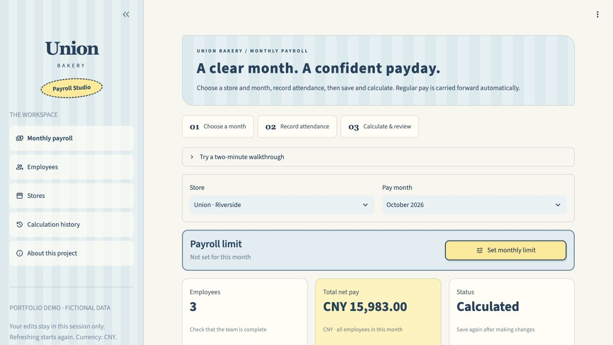
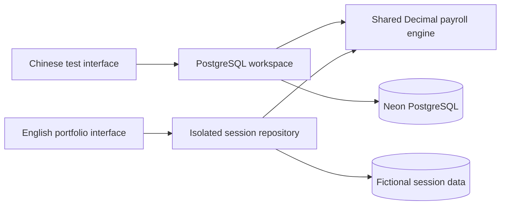

# Union Bakery · Payroll Studio

A payroll workspace for a small bakery, developed through owner feedback: reusable employee records, monthly attendance, transparent calculations and versioned history.

**[Live English demo](https://union-bakery-payroll-portfolio.onrender.com)** · **[中文项目说明](README.zh-CN.md)** · **[Architecture & case study](docs/portfolio-case-study.md)** · **[Product roadmap](docs/product-roadmap.md)**

Development record: [2026-10-25 Chinese AI-entry changes, verification and handover](docs/2026-10-25-ai-entry-handover.md). The Qwen-assisted entry described there is available in the Chinese test workspace, not the public English demo.

The Chinese single-owner release now includes a separate owner login, database environment checks, payroll confirmation/locking, payment-status recording, reasoned corrections, an audit trail and backup/restore tooling. See the [owner operations guide](docs/production-owner-guide.md). These features are separate from the public demo; first-month business reconciliation is still required before relying on the app for payment.

The English portfolio demo runs independently of the Chinese owner-testing environment. Both use the same tested Python calculation engine. The public demo contains fictional data only, isolates changes to each visitor’s session and never reads the owner database connection.



## What you can try

- Maintain stores and employees, individually or in a batch table.
- Start a pay month from regular pay; keep monthly snapshots independent of later salary changes.
- Record absence, lateness, overtime and non-financial performance notes.
- Save inputs separately, or save and calculate in one step.
- Inspect component deductions, compare calculation versions and export English Excel detail.
- Set a monthly payroll limit without displaying its amount in everyday views.

**Two-minute walkthrough:** in Monthly payroll, select Alex Baker. Change **Late minutes** from **7** to **10**, then click **Save & calculate**. Alex’s net pay changes from **CNY 5,263** to **CNY 5,260**. Calculation history preserves both versions. Use **Reset my demo** to start again.

These are store-specific rules and CNY amounts, retained from the original requirements. An English interface does not make this a New Zealand payroll or tax-compliance product. No payment or email is sent.

## Two environments, one calculation engine

| | Chinese owner-testing app | English portfolio demo |
|---|---|---|
| Entry point | `app.py` | `portfolio_app.py` |
| Storage | PostgreSQL on Neon | Per-session in-memory synthetic repository |
| Hosting | Render, password-protected | Separate public Render service |
| Persistence | Saved records survive reconnects | Refresh/reset starts a fresh demo |
| Intended use | Owner acceptance testing with fictional data | Recruiter/portfolio exploration |
| Calculation | `core/payroll_calc.py` | Same engine and rule version |



The demo adapter is not a substitute for database integration testing. Transaction, constraint and concurrency behavior is tested separately against real PostgreSQL.

## Run the English demo locally

Python 3.12 is recommended. No database or credentials are needed.

```sh
python3 -m venv .venv
source .venv/bin/activate
python -m pip install -r requirements.txt
sh scripts/run_portfolio.sh
```

Open `http://127.0.0.1:18502`. The Chinese local app remains available through `sh scripts/run_local.sh`; see the [Chinese setup guide](README.zh-CN.md).

## Tests

```sh
# Engine, exports, public demo and UI tests; PostgreSQL-dependent tests skip.
python -m unittest discover -s tests -v

# Full regression suite against an existing local development database.
TEST_DATABASE_URL='postgresql://localhost:5432/bakery_payroll_dev' \
  python -m unittest discover -s tests -v
```

Database integration tests use isolated schemas. Do not point this test command at a production database. The runtime app account deliberately lacks the schema-management privileges needed by those tests.

## Repository map

| Path | Responsibility |
|---|---|
| `core/payroll_calc.py` | Input validation, Decimal arithmetic, component rounding |
| `core/workspace.py` | Employee records, monthly snapshots, atomic batch operations |
| `core/payroll_storage.py` | Versioned calculations, current results and history |
| `database/001…003*.sql` | Reproducible schema and migration scripts |
| `views/`, `ui/` | Chinese operational interface |
| `portfolio/app.py` | English interface and project walkthrough |
| `portfolio/demo.py` | Bounded synthetic data isolated per visitor session |
| `portfolio/domain.py` | English field labels, validation and Excel export |
| `tests/` | Core behavior, PostgreSQL integration and Streamlit UI coverage |
| `render.yaml` | Chinese owner-testing deployment reference |
| `render.portfolio.yaml` | Independent English demo deployment reference |

## Delivery and data handling

The owner test app runs on Render with an independent Neon test database. SQL migrations, application code and deployment configuration are versioned here; database records and credentials are not. Local `.env.*` files and owner-testing screenshots are excluded from Git.

The public English service needs no database URL and no shared test password. Demo limits cap stores, employees, months and calculation history. It is a portfolio environment, with no guarantee of durable storage. Render Free services may sleep when idle; opening the demo can take roughly a minute to wake it. See [Render’s free-service documentation](https://render.com/docs/free).

Payslips, email delivery, scoped manager access and analytics are planned in the [roadmap](docs/product-roadmap.md). They are not advertised as completed functionality.
